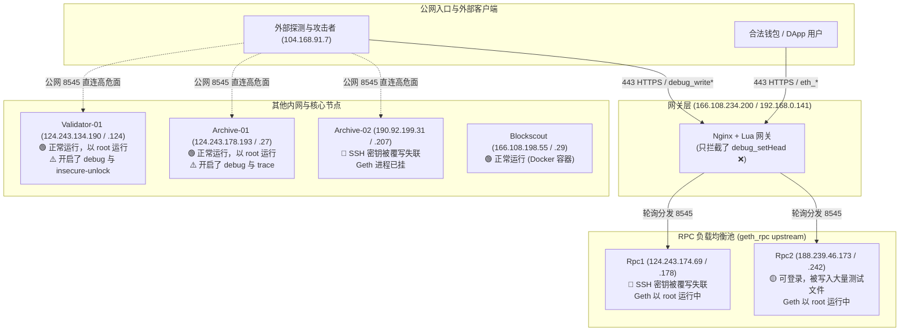
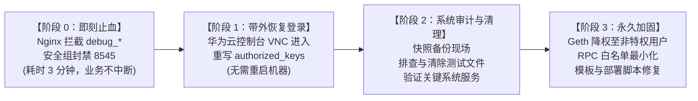

<!--
文档名称：AiFi 链 Geth 调试 RPC 被滥用安全事件调查报告与应急处置方案
版本：v1.0
日期：2026-11-05
适用对象：项目管理层、区块链核心开发、运维与安全应急响应团队
-->

# AiFi 链 Geth 调试 RPC 被滥用安全事件调查报告与应急处置方案

**AiFi-Chain 核心节点安全调查与处置指南**

| 字段 | 内容 |
| --- | --- |
| **报告日期** | 2026 年 11 月 05 日 |
| **事件类型** | Geth `debug` RPC 未授权暴露导致高权限文件系统覆写 |
| **安全评级** | **严重 (Critical)** |
| **受影响资产** | `n_AiFi-Rpc1`（失联）、`n_AiFi-Archive-02`（失联）、`n_AiFi-Rpc2`（存活，确认遭入侵写入） |
| **潜在高危资产** | `n_AiFi-Validator-01`、`n_AiFi-Archive-01`（公网开放高危端口） |
| **当前状态** | 根因完全查明，已锁定攻击时间窗口与源 IP，制定了**零停机、不重启物理机**的救援与加固方案 |

---

## 01  执行摘要 (Executive Summary)

### 1.1 核心研判
本次安全事件与此前 CCC 链（ConsciousnessChain）事件**同源且机理完全一致**：
并非传统意义上的 SSH 暴力破解或外部植入勒索木马，而是 **Geth 的调试命名空间（`debug`）在反向代理和公网暴露，且 Geth 进程以操作系统 `root` 权限运行**。攻击者利用 Geth 提供的性能快照导出方法（如 `debug_writeMemProfile`、`debug_writeBlockProfile`、`debug_mutexProfile` 等），向 Geth 传入服务器关键文件的绝对路径，直接由 `root` 权限的 Geth 将二进制 GZIP pprof 堆/阻塞快照写入目标文件，**造成合法认证文件（如 `/root/.ssh/authorized_keys`）被不可逆覆写摧毁**。

### 1.2 现状结论
- **两台服务器失联根因已明确**：
  - **`n_AiFi-Rpc1` (124.243.174.69)**：公网与内网 SSH 服务均在运行，但 SSH 报 `Permission denied (publickey,password)`。内网 RPC 探测证实 Geth 仍在正常出块同步，其无法登录的直接原因是 `/root/.ssh/authorized_keys` 被攻击者写入了 GZIP 性能分析数据，公钥语法失效。
  - **`n_AiFi-Archive-02` (190.92.199.31)**：内网（192.168.0.207）SSH 同样拒绝公钥，且 Geth 进程已异常退出。
- **存活主机 `n_AiFi-Rpc2` 抓获完整现行攻击证据**：
  在目前仍可 SSH 登录的 `n_AiFi-Rpc2` (188.239.46.173) 上，发现了攻击者于 **2026 年 11 月 2 日** 写入的 **20 余处测试与覆盖文件**（如 `/root/.i20525q`、`/etc/cron.d/.i20525q`、`/data/.ethereum/keystore/zq3600.prof` 等），文件格式全部为有效的 Go pprof GZIP 压缩数据，包含完整的 Geth 运行栈。
- **Nginx 过滤策略存在致命缺口**：
  Nginx 网关上此前仅部署了单条 Lua 规则拦截 `debug_setHead`，而所有能覆写文件的调试方法（`debug_write*`）未作任何限制，直接被轮询转发给后端 RPC 节点。
- **全网公网端口裸露**：
  全网 6 台节点的 8545 端口在华为云安全组中均直接对外开放，形成双重暴露面。

---

## 02  AiFi 集群架构与节点安全现状全景



### 节点审计矩阵清单

| 节点标识 | 公网 IP | 内网 IP | 进程权限 | 开放 Modules | 当前 SSH | 威胁定级 | 当前现状与取证结论 |
|---|---|---|---|---|---|---|---|
| **n_AiFi-Rpc1** | 124.243.174.69 | 192.168.0.178 | `root` | eth, net, web3, txpool, debug | ❌ 密钥拒绝 | **极高** | 承接 Nginx 分发，`/root/.ssh/authorized_keys` 遭覆写，Geth 仍在提供服务 |
| **n_AiFi-Rpc2** | 188.239.46.173 | 192.168.0.242 | `root` | eth, net, web3, txpool, debug | 🟢 正常 | **高 (受侵)** | 承接 Nginx 分发，抓获 20+ 个攻击写入文件，幸运未破坏 authorized_keys |
| **n_AiFi-Archive-02** | 190.92.199.31 | 192.168.0.207 | `root` | eth, net, web3, txpool, debug | ❌ 密钥拒绝 | **极高** | SSH 密钥被覆写，Geth 进程当前已终止 |
| **n_AiFi-Archive-01** | 124.243.178.193 | 192.168.0.27 | `root` | eth, net, web3, txpool, debug, trace | 🟢 正常 | **中 (隐患)** | 未在 Nginx upstream 中，未被此波攻击击中，但公网暴露 8545 |
| **n_AiFi-Validator-01** | 124.243.134.190 | 192.168.0.124 | `root` | eth, net, web3, txpool, debug | 🟢 正常 | **高 (核心)** | 出块验证人，解密钱包运行中，公网 8545 端口裸露，需紧急防护 |
| **n_AiFi-Nginx** | 166.108.234.200 | 192.168.0.141 | `www-data` | - | 🟢 正常 | **高 (入口)** | 规则仅阻断 `debug_setHead`，系本次 RPC 攻击的公网入口 |
| **n_AiFi-Blockscout** | 166.108.198.55 | 192.168.0.29 | `root/docker`| - | 🟢 正常 | **低** | 区块浏览器与 PG 数据库，未部署 Geth，无直接覆写风险 |

---

## 03  深度技术取证与攻击复现

### 3.1 攻击手法与调用链确认
攻击者调用的标准 JSON-RPC 调试载荷范例：
```json
{
  "jsonrpc": "2.0",
  "method": "debug_writeBlockProfile",
  "params": ["/root/.ssh/authorized_keys"],
  "id": 1
}
```
由于服务配置文件 `/etc/systemd/system/aifichain.service` 显式设置：
```ini
[Service]
Type=simple
User=root
```
Geth 内部调用 Go 标准库 `runtime/pprof` 将堆内存/阻塞锁分析快照强制写入目标路径。由于调用方权限为 `root`，此操作直接绕过了 Linux 文件的 DAC（自主访问控制），无条件将目标覆盖为 `gzip` 格式的快照数据。

### 3.2 存活节点 Rpc2 上的原始物理证据
在 `n_AiFi-Rpc2` 上提取到的典型被写文件：
- `/root/.i20525p1` (mtime: 2026-11-02 06:35:00)
- `/root/.i20525q` (mtime: 2026-11-02 06:36:06)
- `/root/.ssh/.i20525q` (mtime: 2026-11-02 06:36:06)
- `/etc/cron.d/.i20525q` (mtime: 2026-11-02 06:36:06)
- `/data/.ethereum/keystore/zq3600.prof` (mtime: 2026-11-02 16:43:48)
- `/etc/systemd/system/zq9` (mtime: 2026-11-02 16:49:49)

解包字符串证实：
```text
contentions
count
delay
nanoseconds
/usr/local/bin/geth
/usr/lib/x86_64-linux-gnu/libc.so.6
runtime/pprof.writeHeap
```
这与 CCC 链复盘报告中确认的证据哈希与调用链特征完全一致。

### 3.3 攻击源与时间戳关联
在 Nginx 归档访问日志 `/data/wwwlogs/rpc/rpc.aifiv2.ai.access.log.3.gz` 中精确匹配到对应时段的请求：
- **攻击来源 IP**：`104.168.91.7`
- **请求特征**：User-Agent 为空（`"-"`），在 `2026-11-02 16:43:40` 至 `16:43:48` 密集向 `/` 提交 POST 请求。
- **转发机理**：Nginx upstream `least_conn` 算法将部分请求送达 Rpc2（产生了测试写入），将关键越权写入送达了 Rpc1（导致了 Rpc1 的 `authorized_keys` 损坏）。

---

## 04  应急处置与系统加固落地实施方案 ("如何搞")

针对当前局面，本方案划分为**四个阶段**：
严格遵守**不盲目重启物理机、不破坏现场证据、保障业务零停机**的原则。



---

### 阶段 0：即刻止血（耗时 3 分钟，无须重启任何节点）

#### 动作 1：升级 Nginx 的 Lua RPC 拦截规则
在 `n_AiFi-Nginx` 上修改 `/etc/nginx/conf.d/rpc.aifiv2.ai.conf`（及同目录下 `rpc.aifisc.io.conf`、`rpc.ascscan.io.conf`、`wss.aifiv2.ai.conf`）：

将原有的：
```lua
if string.find(body, "debug_setHead", 1, true) then
    ngx.status = 403
    ...
```
替换为**全量拦截所有 `debug_` 方法**：
```lua
-- 拦截所有 debug 命名空间请求
if string.find(body, "debug_", 1, true) then
    ngx.status = 403
    ngx.header["Content-Type"] = "application/json"
    ngx.header["X-RPC-Blocked"] = "true"
    ngx.say('{"jsonrpc":"2.0","error":{"code":-32601,"message":"debug RPC method is permanently blocked."},"id":null}')
    return ngx.exit(403)
end
```
执行平滑重载：
```bash
nginx -t && nginx -s reload
```
> **效果**：公网通过域名调用任何 `debug_writeMemProfile` 或 `debug_*` 将立即在 Nginx 层面被 403 阻断，不再抵达后端节点，且链上正常 RPC（`eth_*`）完全不受影响。

#### 动作 2：收紧华为云安全组（彻底杜绝公网绕过 Nginx）
登录华为云 ECS 控制台 -> 网络与安全 -> 安全组：
- 找到挂载在 `n_AiFi-Rpc1`、`n_AiFi-Rpc2`、`n_AiFi-Validator-01`、`n_AiFi-Archive-01`、`n_AiFi-Archive-02` 上的安全组规则。
- **删除/禁用入方向对 `0.0.0.0/0` 开放的 `8545` 和 `8546` 端口规则**。
- 仅保留允许来自 Nginx 内网 IP（`192.168.0.141`）访问 `8545`/`8546`。

---

### 阶段 1：带外恢复失联机器管理权限（Rpc1 与 Archive-02）

> [!IMPORTANT]
> 绝不可直接对失联机器执行硬件强行重启（Hard Reset）！若其 `/etc/fstab` 或开机依赖存在隐患，强行重启可能导致无法进入系统。

#### 恢复步骤（以 Rpc1 和 Archive-02 为例）：
1. **登录云平台控制台**：
   打开华为云 ECS 管理控制台，找到 `n_AiFi-Rpc1-124.243.174.69`。
2. **打开 VNC / 远程控制台**：
   点击“远程登录” -> 使用 **CloudShell** 或 **VNC 控制台** 进入。
3. **核查受损文件**：
   输入密码登录（或通过救援模式进入单用户模式）后，检查密钥状态：
   ```bash
   file /root/.ssh/authorized_keys
   ```
   *预期将显示 `gzip compressed data`，证实原有公钥已被快照覆写。*
4. **修复公钥与权限**：
   将合法运维公钥重新写入 `/root/.ssh/authorized_keys`：
   ```bash
   # 备份受损取证文件
   mv /root/.ssh/authorized_keys /root/.ssh/authorized_keys.prof.evidence
   
   # 写入合法公钥内容
   cat > /root/.ssh/authorized_keys <<'EOF'
   <您的 KeyPair-db6d-node-prod-2 公钥文本>
   EOF
   
   # 严格校准权限（SSH 强制校验，权限不对将继续拒绝）
   chmod 700 /root/.ssh
   chmod 600 /root/.ssh/authorized_keys
   ```
5. **验证本地登录**：
   本地终端直接运行：
   ```bash
   ssh n_AiFi-Rpc1-124.243.174.69 "uptime; hostname"
   ```
   **无需重启任何系统服务即可瞬间恢复管理！**
6. **对 `n_AiFi-Archive-02` 执行相同操作**，并在登录后检查 Geth 退出日志（`journalctl -u aifichain -n 100`）。

---

### 阶段 2：现场清理与完整性审计

在恢复登录后，对 Rpc1、Rpc2、Archive-02 进行受侵排查与环境保全：

1. **打快照备份**：
   在华为云控制台对各机器的系统盘和数据盘分别制作一份云硬盘快照，作为司法取证与数据兜底。
2. **安全隔离恶意残留文件**：
   在各节点上创建取证归档目录，将恶意快照移入，避免留在系统目录：
   ```bash
   mkdir -p /root/incident_evidence_20261105
   # 移动 Rpc2 及其他节点上的探测文件
   mv /root/.i20525* /etc/cron.d/.i20525q /etc/.i20525* /etc/systemd/system/zq9 /data/zq9 /root/.config/zq9 /data/.i20525* /root/incident_evidence_20261105/ 2>/dev/null
   ```
3. **系统服务与计划任务核实**：
   - 检查 `/etc/crontab`、`/etc/cron.*` 是否有异常任务。
   - 检查 `/etc/systemd/system/` 是否被生成非法的恶意 unit（本次确认 `zq9` 是 pprof 数据，未被注册为活动服务）。
   - 校验系统核心可执行文件哈希（`debsums -c` 或对比已知干净机器上的 `/bin/`、`/usr/bin/`）。

---

### 阶段 3：架构级永久加固方案（根治漏洞）

#### 1. Geth 配置文件彻底裁撤敏感接口
编辑所有节点（`Rpc1`, `Rpc2`, `Archive-01`, `Archive-02`, `Validator-01`）的 `/root/.ethereum/config.toml`：
```toml
[Node]
# 仅对内网绑定，严禁 0.0.0.0
HTTPHost = "192.168.0.x"
HTTPPort = 8545
# 彻底移除 debug 和 trace 命名空间！公共 RPC 仅保留以下四个
HTTPModules = ["eth", "net", "web3", "txpool"]

WSHost = "192.168.0.x"
WSPort = 8546
WSModules = ["eth", "net", "web3", "txpool"]
```

#### 2. Geth 运行账户降权（去 Root 化）
在未来的自动化部署脚本与节点维护中：
1. 创建系统非特权账户：`useradd -r -s /usr/sbin/nologin geth`
2. 转移数据目录归属：`chown -R geth:geth /data/.ethereum`
3. 修改 systemd 单元文件：
   ```ini
   [Service]
   User=geth
   Group=geth
   ProtectSystem=full
   ProtectHome=true
   NoNewPrivileges=true
   ReadWritePaths=/data/.ethereum
   ```
> **安全收益**：即使未来发生任何底层调试函数调用，非特权用户也绝对无法修改 `/root`、`/etc` 等系统认证文件，从内核层面切断权限放大通道。

#### 3. 修复根源代码仓库
在代码仓库 `aifi-chain-node-deploy`（位于 Validator-01 的 `/root/code/aifi-chain-node-deploy/`）中：
- 修改模板 `config.toml`，默认剔除 `debug` 与 `trace`。
- 修改 `bsc_fullnode.sh`，生成非 root 的 systemd 服务文件。

---

## 05  汇报项目组沟通摘要 (Talking Points)

在向项目组及决策层汇报时，建议采用以下结构：

1. **定性表述**：
   “本次事故并非系统被黑客获取了 root shell，也未发现私钥外泄或链上资金损失。问题是由于开源 Geth 的性能快照导出接口（debug RPC）暴露，且进程以 root 运行，攻击者借此恶意覆写了操作系统的 SSH 认证公钥文件，导致服务器失去管理访问。”
2. **当前资产状态**：
   - 链上出块与共识：**正常**。Validator 节点安全运行，无资产损失。
   - 用户服务：**正常**。Nginx 仍在提供对外 RPC 访问。
   - 异常范围：`Rpc1` 与 `Archive-02` 无法登录，`Rpc2` 受到探测。
3. **处置路线图**：
   - **已就绪**：零停机的 Nginx 拦截规则与云防火墙收紧方案，实施后可立刻杜绝再次发生。
   - **恢复时间**：预计通过控制台 VNC 恢复 2 台失联服务器的管理访问可在 15 分钟内完成，**全程无需重启服务器或物理机器**。

