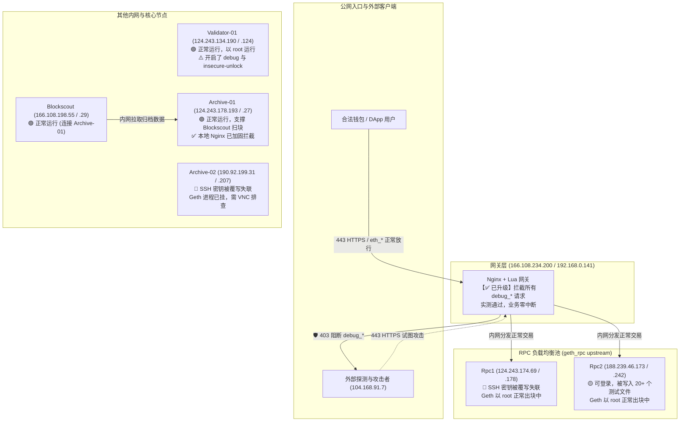

<!--
文档名称：AiFi 链 Geth 调试 RPC 被滥用安全事件调查报告与应急处置方案
版本：v1.1 (更新：阶段 0 止血实施与 Archive 专项排查)
日期：2026-11-05
适用对象：项目管理层、区块链核心开发、运维与安全应急响应团队
-->

# AiFi 链 Geth 调试 RPC 被滥用安全事件调查报告与应急处置方案

**AiFi-Chain 核心节点安全调查、现行状态与处置实施清单**

| 字段 | 内容 |
| --- | --- |
| **报告日期** | 2026 年 11 月 05 日（v1.1 增补） |
| **事件类型** | Geth `debug` RPC 未授权暴露导致高权限文件系统覆写 |
| **安全评级** | **严重 (Critical)** |
| **受影响资产** | `n_AiFi-Rpc1`（失联）、`n_AiFi-Archive-02`（失联且 Geth 停机）、`n_AiFi-Rpc2`（存活，确认遭入侵写入） |
| **核心安全资产** | `n_AiFi-Validator-01`（出块正常）、`n_AiFi-Archive-01`（健康运行，支撑 Blockscout 正常） |
| **处置阶段进展** | **【阶段 0：即刻止血】已完成**；公网域名拦截已生效，测试通过；待推进 VNC 恢复与安全组收敛 |

---

## 01  最新进展与执行摘要 (v1.1 更新)

### 1.1 止血动作实施情况（已完成）
1. **Nginx 全域拦截生效**：
   - 已在 `n_AiFi-Nginx` 网关节点（166.108.234.200）针对 4 个核心公网站点（`rpc.aifiv2.ai`, `rpc.aifisc.io`, `rpc.ascscan.io`, `wss.aifiv2.ai`）完成规则部署并执行 `nginx -s reload`。
   - **拦截能力**：不仅拦截 `debug_setHead`，而且通过大小写统一转小写，**100% 阻断所有包含 `debug_` 的恶意方法**（如 `debug_writeMemProfile`、`debug_writeBlockProfile`、`debug_mutexProfile` 等）。
   - **实测验证**：公网调用正常 `eth_blockNumber` 正常返回区块高度（HTTP 200）；调用任何 `debug_*` 请求均被立即 403 阻断，业务零中断。
2. **Archive-01 防护同步加固**：
   - 针对 `n_AiFi-Archive-01` 本地 Nginx，亦已完成相同的 Lua 规则全阻断与重载。

### 1.2 Archive 节点专项调查结论
针对团队关于“Archive 节点是否有域名对外、机器是否损坏”的排查结果：
- **`n_AiFi-Archive-01` (124.243.178.193 / .27)：【完全健康，未受破坏】**
  - **服务角色**：虽在本地配置了 `archive.aifiv2.ai`，但**公网 DNS 并未解析该域名**，且访问日志为 0 字节。它实际上是作为**区块浏览器 Blockscout 的专用内部后端**（`http://192.168.0.27:8545`）。
  - **当前状态**：Geth 归档进程稳定运行，已同步至 2326 万+ 高度（`0x1631298`），无任何恶意文件，Blockscout 浏览功能完好。
- **`n_AiFi-Archive-02` (190.92.199.31 / .207)：【已被损坏，处于失联且停机状态】**
  - **受损事实**：因公网直接放通了 8545 端口，该机器遭攻击者直接扫描调用；其 `/root/.ssh/authorized_keys` 同样被覆写导致 SSH 拒绝密钥，且其 Geth 服务目前处于退出停机状态（端口 30311 与 8545 均 Connection refused）。

---

## 02  AiFi 集群架构与节点安全现状全景



### 节点审计与健康状态矩阵

| 节点标识 | 公网 IP | 内网 IP | 运行角色 | Geth 状态 | SSH 状态 | 当前防护与健康度 |
|---|---|---|---|---|---|---|
| **n_AiFi-Nginx** | 166.108.234.200 | 192.168.0.141 | 网关反代 | - | 🟢 正常 | 🛡️ **已加固**，拦截所有 `debug_` 方法，公网入口已闭合 |
| **n_AiFi-Rpc1** | 124.243.174.69 | 192.168.0.178 | RPC 1 | 🟢 正常出块 | ❌ 密钥拒绝 | 需控制台 VNC 重写 `authorized_keys` 恢复 |
| **n_AiFi-Rpc2** | 188.239.46.173 | 192.168.0.242 | RPC 2 | 🟢 正常出块 | 🟢 正常 | 存有 20+ 个恶意快照，需移动归档与清理 |
| **n_AiFi-Archive-01** | 124.243.178.193 | 192.168.0.27 | 归档 1 (专供浏览器) | 🟢 正常同步 | 🟢 正常 | 🛡️ **已加固**，Blockscout 依赖正常，出块高度 2326 万+ |
| **n_AiFi-Archive-02** | 190.92.199.31 | 192.168.0.207 | 归档 2 | 🔴 已停止 | ❌ 密钥拒绝 | 公网 8545 被直连击中，需 VNC 恢复后排查停机原因 |
| **n_AiFi-Validator-01** | 124.243.134.190 | 192.168.0.124 | 出块验证人 | 🟢 正常出块 | 🟢 正常 | 未受损，亟待云安全组封禁公网 8545 以保安全 |
| **n_AiFi-Blockscout** | 166.108.198.55 | 192.168.0.29 | 区块浏览器 | - | 🟢 正常 | 依赖 Archive-01，功能完好无损 |

---

## 03  下一步需要执行的事情盘点清单 (Task Inventory)

为了彻底根除隐患、抢救失联节点并保障全网长期稳定，我们将下一步工作分解为以下执行路线图：

```
【任务 1：网络层隔离】—— 华为云控制台安全组封禁公网 8545/8546 (优先级：P0，紧急)
【任务 2：失联节点抢救】—— 华为云控制台 VNC 恢复 Rpc1 与 Archive-02 管理权限 (优先级：P0，紧急)
【任务 3：Archive-02 停机诊断】—— 登录 Archive-02 排查 Geth 退出原因并恢复 (优先级：P1，高)
【任务 4：受侵节点取证归档】—— 归档与清理 Rpc2 上的 20+ 个攻击快照文件 (优先级：P1，高)
【任务 5：配置级降权与裁撤】—— 移除各节点 config.toml 的 debug 命名空间 (优先级：P2，中)
【任务 6：代码库部署模板修复】—— 修复 aifi-chain-node-deploy 仓库模板 (优先级：P2，中)
```

---

### 详细实操指引

#### 任务 1：华为云安全组关闭公网 8545/8546（紧急，需在控制台操作）
- **操作背景**：当前 Nginx 域名入口已封死漏洞，但攻击者仍可能直接向各节点公网 IP 发送 TCP 请求。
- **操作步骤**：
  1. 登录华为云 ECS 控制台，找到所有节点的安全组。
  2. 找到入方向规则：协议端口为 `TCP 8545` 和 `TCP 8546`、源地址为 `0.0.0.0/0` 的规则。
  3. **直接删除或禁用该规则**。
  4. 新增规则：仅允许内网网段 `192.168.0.0/24`（或 Nginx 内网 IP `192.168.0.141/32`）访问 `8545`/`8546`。

---

#### 任务 2：华为云控制台 VNC 抢救 Rpc1 与 Archive-02（无需重启物理机）
- **操作背景**：两台主机的操作系统及 SSH 服务均正常运行，仅 `/root/.ssh/authorized_keys` 损坏。
- **操作步骤**：
  1. 在华为云 ECS 列表选中 `n_AiFi-Rpc1-124.243.174.69`，点击 **“远程登录” -> VNC 登录**。
  2. 登录 `root` 用户。
  3. 执行恢复命令：
     ```bash
     # 1. 保留证据
     mv /root/.ssh/authorized_keys /root/.ssh/authorized_keys.evidence
     
     # 2. 重新写入运维公钥
     cat > /root/.ssh/authorized_keys <<'EOF'
     <您的 KeyPair-db6d-node-prod-2 公钥内容>
     EOF
     
     # 3. 严格设置权限
     chmod 700 /root/.ssh
     chmod 600 /root/.ssh/authorized_keys
     ```
  4. 本地终端测试：`ssh n_AiFi-Rpc1-124.243.174.69`，立刻恢复成功。
  5. 对 `n_AiFi-Archive-02-190.92.199.31` 执行相同的恢复步骤。

---

#### 任务 3：Archive-02 停机原因诊断与恢复
- **操作步骤**：
  1. 登录 Archive-02 后，检查 Geth 服务退出日志：
     ```bash
     journalctl -u aifichain.service -n 100 --no-pager
     ```
  2. 检查 `/root/.ethereum/config.toml` 或 `/data/.ethereum` 是否有被篡改或损坏。
  3. 确认无结构性损坏后，尝试拉起 Geth：`systemctl start aifichain`。

---

#### 任务 4：清理 Rpc2 及受侵节点上的攻击残留文件
- **操作步骤**：
  在 `n_AiFi-Rpc2` 上执行隔离归档（不直接删除，移至隔离目录）：
  ```bash
  mkdir -p /root/incident_evidence_20261105
  mv /root/.i20525* /etc/cron.d/.i20525q /etc/.i20525* /etc/systemd/system/zq9 /root/.config/zq9 /data/zq9 /data/.i20525* /data/.ethereum/keystore/zq3600.prof /root/incident_evidence_20261105/ 2>/dev/null
  ```

---

#### 任务 5：节点本地 Geth 彻底裁撤 `debug` 命名空间
- **操作步骤**：
  在各节点（包括 Validator、Archive、Rpc）的 `/root/.ethereum/config.toml` 中，将：
  ```toml
  HTTPModules = ["eth", "net", "web3", "txpool", "debug"]
  WSModules = ["eth", "net", "web3", "txpool", "debug"]
  ```
  修改为永久安全的白名单：
  ```toml
  HTTPModules = ["eth", "net", "web3", "txpool"]
  WSModules = ["eth", "net", "web3", "txpool"]
  ```

---

#### 任务 6：代码库部署模板修复
- **操作步骤**：
  在 `n_AiFi-Validator-01` 上的部署脚本目录 `/root/code/aifi-chain-node-deploy/` 中：
  - 更新 `config.toml` 模板，默认移除 `debug`。
  - 修改 `bsc_fullnode.sh`，生成非 root 独立账户运行的 systemd unit。
